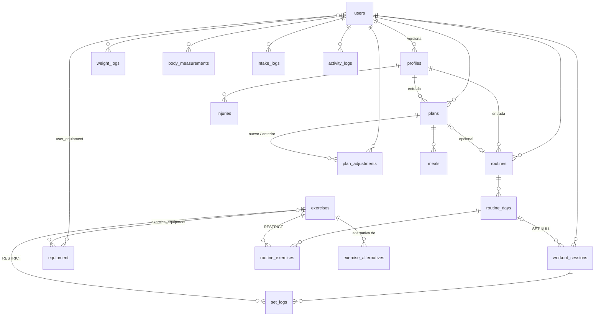

# Modelo de datos

Estado: Fase 2. 20 tablas, SQLAlchemy 2.0, migraciones Alembic desde la primera tabla. Fuente de verdad: `app/models/`. Este documento explica el porqué de cada tabla y sus relaciones.

## Convenciones

- Toda tabla tiene `id` entero autoincremental, `created_at` y `updated_at` (UTC). Las tablas de asociación (`user_equipment`, `exercise_equipment`, `exercise_alternatives`) tienen clave compuesta y `created_at`.
- Enums: VARCHAR(32) + CHECK con los valores de `app/engine/enums.py`. Fácil de leer en SQL, portable, y validado también en Python.
- Fechas de calendario (`date`) para registros diarios; fechas-hora *aware* en UTC para eventos (`started_at`, `completed_at`, `superseded_at`...).
- JSON (JSONB en PostgreSQL) para listas y estructuras que no se consultan por SQL: prioridades, aversiones, contraindicaciones, instantáneas de entrada y salida del motor.
- Borrado: físico en cascada desde `users` (derecho al olvido). Lógico (`deleted_at`) en `users`, `plans`, `routines` y `workout_sessions`. `exercises` referenciados no se pueden borrar (`RESTRICT`); se desactivan con `is_active`.
- Versionado: `profiles`, `plans` y `routines` llevan `version` (único por usuario) y `superseded_at`. Nunca se sobrescribe una versión: se crea la siguiente y se marca la anterior.
- Índices en toda columna de consulta frecuente: `(user_id, fecha)` en los registros, `(user_id, status)` en planes y rutinas, `(exercise_id, completed_at)` en series para las gráficas de progreso.

## Tablas

| Tabla | Para qué | Claves y relaciones |
|---|---|---|
| `users` | Cuenta: email único (normalizado a minúsculas), hash argon2, idioma, zona horaria, consentimiento, último login | Dueña de todo lo demás (cascade) |
| `user_equipment` | Material que tiene el usuario | `user_id` + `equipment_id` |
| `profiles` | Cuestionario completo (bloques A-E) y banderas de seguridad (embarazo/lactancia, TCA). Versionado | `user_id`, `version` único por usuario, `superseded_at` |
| `questionnaire_drafts` | Borrador del cuestionario: respuestas dadas hasta ahora (JSON plano) y último paso completado; se borra al generar el plan | `user_id` único (uno por usuario, cascade) |
| `injuries` | Lesiones declaradas en una versión del perfil, con severidad | `profile_id`; única por (perfil, zona) |
| `weight_logs` | Peso diario | única por (usuario, día) |
| `body_measurements` | Perímetros semanales y % graso opcional con su método | única por (usuario, día) |
| `intake_logs` | Kcal y macros reales del día más adherencia (0-100) (D-07) | única por (usuario, día) |
| `activity_logs` | Pasos y cardio del día | única por (usuario, día) |
| `equipment` | Catálogo de material (32 entradas sembradas) | `code` único |
| `exercises` | Catálogo de ejercicios: músculo primario, secundarios (JSON), patrón, mecánica, fuerza, nivel técnico, unilateral, peso corporal, contraindicaciones (JSON), instrucciones es/en, vídeo, imagen, origen | `slug` único; índices en patrón y músculo |
| `exercise_equipment` | Material que exige cada ejercicio (todo el listado) | `exercise_id` + `equipment_id` |
| `exercise_alternatives` | Sustitutos dirigidos con prioridad y motivo | `exercise_id` → `alternative_id` (no puede ser el mismo) |
| `plans` | Plan nutricional: kcal objetivo, macros, fibra, agua, BMR, TDEE, método, confianza, instantánea de entradas, detalles del motor. Versionado | `user_id`, `profile_id`, `routine_id` opcional |
| `meals` | Reparto por comidas de un plan | `plan_id`; única por (plan, posición) |
| `plan_adjustments` | Auditoría de cada recálculo: motivo, cambio esperado/observado, TDEE observado, deltas, explicación | `plan_id` (nuevo), `previous_plan_id` (anterior) |
| `routines` | Mesociclo: split, días, semanas, descarga, instantánea y detalles. Versionada | `user_id`, `profile_id` |
| `routine_days` | Día de la rutina con foco muscular y duración estimada | `routine_id`; único por (rutina, índice) |
| `routine_exercises` | Prescripción: series, rango de reps, RIR inicial/final, descanso, tempo, incremento de carga | `routine_day_id`, `exercise_id` (RESTRICT) |
| `workout_sessions` | Sesión real: inicio, fin, estado, semana del mesociclo, fatiga percibida | `user_id`, `routine_day_id` opcional (SET NULL) |
| `set_logs` | Serie real: tipo, reps, kg, RIR, hora | `workout_session_id`, `exercise_id` (RESTRICT), `routine_exercise_id` opcional |

## Relaciones

## Rangos comprobados en base de datos (CHECK)

Amplios a propósito: rechazan basura, no personas poco habituales. Los límites clínicos los decide el motor (`safety.py`).

| Tabla.columna | Rango |
|---|---|
| `profiles.height_cm` | 100-250 |
| `profiles.weight_kg`, `weight_logs.weight_kg` | 25-350 |
| `profiles.body_fat_pct`, `body_measurements.body_fat_pct` | 2-70 |
| `profiles.stress_level` | 1-5 |
| `profiles.training_days_per_week` | 1-7 |
| `profiles.session_minutes` | 15-240 |
| `profiles.meals_per_day` | 1-8 |
| `questionnaire_drafts.step` | `>= 0` |
| `intake_logs.calories` | 0-20000 |
| `plans.calorie_target` | 500-10000 |
| `routines.mesocycle_weeks` | 3-8 |
| `routine_exercises.sets` | 1-12 |
| `routine_exercises.rep_min/rep_max` | `rep_min >= 1`, `rep_max >= rep_min` |
| `routine_exercises.rest_seconds` | 15-600 |
| `set_logs.reps` | 0-200 |
| `set_logs.weight_kg` | 0-1000 |
| `workout_sessions.finished_at` | `>= started_at` |

## Migraciones

- Crear: `flask db migrate -m "descripción"` (autogenerada; revisar siempre el fichero).
- Aplicar: `flask db upgrade`. Deshacer: `flask db downgrade -1` o `flask db downgrade base`.
- Los tipos propios se escriben en las migraciones como tipos estándar (`sa.DateTime(timezone=True)`, `sa.JSON().with_variant(postgresql.JSONB(), 'postgresql')`) gracias a `render_migration_item()` en `app/models/base.py`: los ficheros de `migrations/versions/` no importan código de la aplicación.
- Historial: `196ae6a460b6` esquema inicial; `021183cac637` `training_time` y `wants_carb_cycling` en `profiles`; `f3a8881022c3` `questionnaire_drafts`.
- `render_as_batch=True`: en SQLite, alterar tablas implica recrearlas; Alembic lo hace solo si los constraints tienen nombre (de ahí la convención).
